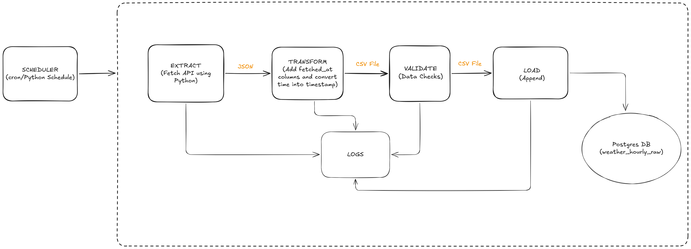
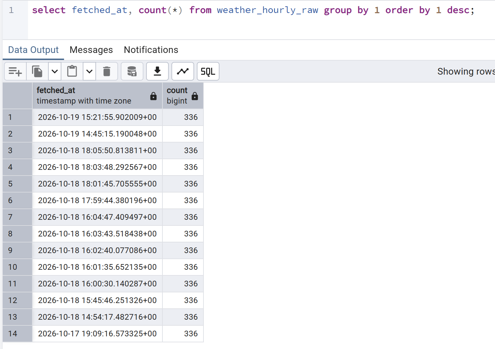

# Weather Pipeline

Weather forecasts change from one run to the next. This pipeline pulls a 14-day hourly forecast for one location from the [Open-Meteo API](https://open-meteo.com/) every 6 hours and keeps every run in Postgres, so you can see how the forecast for the same hour changed over time. It is a batch ETL pipeline: four separate Python stages run in order under a scheduler, and everything starts with one command, `docker compose up`. The same four stages also run as an Apache Airflow DAG (see [Orchestration with Airflow](#orchestration-with-airflow)).

## Architecture



## Pipeline stages

1. **Extract** (`open_api_requests.py`): calls the API with `requests`, saves the JSON response and writes the hourly data to a CSV. It adds a `fetched_at` column, stamped in UTC right after the API call returns, which identifies the run.
2. **Transform** (`transform.py`): converts `time` from text to a timestamp, from IST (Asia/Kolkata) to UTC, and `fetched_at` to a UTC timestamp.
3. **Validate** (`validate.py`): checks the transformed data: row counts (input equals output, 336 rows = 24 hours x 14 days), no nulls, values in plausible ranges, no duplicate (`time`, `fetched_at`) pairs, and a single `fetched_at` per run. Any failure exits with a non-zero code.
4. **Load** (`data_load.py`): creates the `weather_hourly_raw` table if needed and inserts the rows, skipping any that already exist (`ON CONFLICT DO NOTHING`).

Around the stages:

- **Scheduler** (`scheduler.py`): runs the four stages in order using the `schedule` library, once at startup and then on an interval set by `SCHEDULE_INTERVAL_MINUTES` (360 = 6 hours). Each stage's exit code decides whether the next one runs.
- **Postgres**: a Postgres 16 container with a health check; the data lives in a named Docker volume.

## Design decisions

- **Append-only history.** Every run adds 336 rows. The primary key is (`time`, `fetched_at`), so the same forecast hour can appear once per run.
- **Idempotent load.** Loading the same run twice inserts nothing (conflicts are skipped); a new run adds new rows.
- **Atomic load.** The table creation and insert run in one transaction, so a failed load leaves all rows or none.
- **Failure handling.** A failed stage is logged with its name and exit code, later stages do not run, and nothing is loaded. The scheduler stays alive and tries again at the next interval.
- **Retry with backoff.** Extract retries timeouts, connection errors and 5xx responses up to 5 times, waiting 5s, 10s, 20s and 40s between attempts. 4xx errors fail immediately because retrying a bad request cannot help. If every attempt fails, Extract exits non-zero and the failure handling above applies.
- **Logging.** Each stage writes its own log file to `output/`.

## Tech stack

Python 3.11, `requests` 2.34.2, `pandas` 3.0.5, SQLAlchemy 2.1.3 with `psycopg2-binary` 2.9.13, `schedule` 1.2.2, Postgres 16, Docker Compose.

## Data

Hourly forecasts for one location (set in the API URL in `open_api_requests.py`), stored in the `weather_hourly_raw` table with these columns: `time`, `temperature_2m`, `apparent_temperature`, `precipitation_probability`, `rain`, `showers` and `fetched_at`.

## Run it

You need Docker and Docker Compose.

1. Create your settings file from the template and fill in the values:
   ```
   cp .env.example .env
   ```
   It holds the database credentials, `SCHEDULE_INTERVAL_MINUTES`, and `POSTGRES_HOST` / `POSTGRES_PORT` for running the scripts outside Docker (inside Compose, the host and port are set for you).
2. Build and start everything:
   ```
   docker compose up --build -d
   ```
   The first pipeline run starts immediately. Follow it in `output/scheduler.log`.
3. Look at the data: connect any Postgres client (pgAdmin, psql) to `localhost`, port `5433`, with the database name, user and password from your `.env`, and run:
   ```sql
   SELECT fetched_at, COUNT(*) FROM weather_hourly_raw GROUP BY 1 ORDER BY 1 DESC;
   ```
   Each run shows up as one `fetched_at` value with 336 rows.

   

To stop everything: `docker compose down`. Add `-v` to also delete the database volume (and with it, the whole run history).

## Orchestration with Airflow

The `airflow/` folder runs the same four stages as an Airflow 3 DAG (`weather_pipeline_dag`) with the Celery executor, instead of the built-in `scheduler.py`.

**How the DAG works**

- Four `PythonOperator` tasks run in order: `extract >> transform >> validate >> load`. Each task calls the stage's `main()`. The stage modules are imported inside the task functions, so parsing the DAG never runs pipeline code.
- Schedule `0 */6 * * *` (00:00, 06:00, 12:00 and 18:00 UTC), `catchup=False` and `max_active_runs=1`.
- If a task fails, the tasks after it are marked `upstream_failed` and do not run. Validation raises an error on any failed check, so bad data never reaches `load`.

**Retries**

| Task | Retries | Why |
|---|---|---|
| `extract` | 1, after 5 minutes | The script already makes up to 5 attempts with backoff on transient errors; this covers a longer outage. |
| `transform` | 0 | Deterministic: the same input always gives the same output, so a retry cannot help. |
| `validate` | 0 | Deterministic: a failed check means the data is bad. Fail fast so nothing bad is loaded. |
| `load` | 2, after 2 minutes each | Database errors can be transient. The load is one transaction and idempotent, so a retry is safe. |

`max_active_runs=1` is there because the stages pass data to each other through CSV files in the shared `output/` folder, so two overlapping runs could overwrite each other's files. `catchup=False` skips missed intervals instead of replaying them, which is what a forecast pipeline wants.

**Run it**

1. Create the shared Docker network once: `docker network create weather_net`
2. From the repo root, start only the database: `docker compose up -d postgres`. Do not start the `pipeline` service as well, or its own scheduler and Airflow would both write to the same table.
3. `cd airflow`, then `cp .env.example .env` and fill in `POSTGRES_USER`, `POSTGRES_PASSWORD` and `POSTGRES_DB` with the same values as the root `.env`. Keep `POSTGRES_HOST=my_postgres` and `POSTGRES_PORT=5432`.
4. First time only: `docker compose up airflow-init`. Then `docker compose up -d`.
5. Open http://localhost:8080 (login `airflow` / `airflow`) and unpause `weather_pipeline_dag`.

**How the two stacks connect**

The Postgres stack and the Airflow stack each have their own default Docker network, so containers in one cannot see the other. `weather_net` is a shared network created outside both Compose files and declared `external: true` in each, so Compose uses it and never creates or deletes it. Docker's built-in DNS lets containers on it find each other by name.

- The database container joins `weather_net` as well as its default network.
- Only the Airflow `worker` joins `weather_net`, because it is the only service that runs the `load` task.
- Both stacks have a service called `postgres`, and Airflow has its own metadata database. So the load connects to `my_postgres`, the unique `container_name` of the weather database, on the container port 5432. `localhost` would mean the worker container itself.

## Project layout

```
open_api_requests.py   extract: fetch the API data, write JSON and CSV
transform.py           transform: fix timestamps and time zones
validate.py            validate: data quality checks
data_load.py           load: append the rows into Postgres
scheduler.py           run the four stages in order, on a schedule
Dockerfile             image used by the pipeline service
docker-compose.yml     the postgres and pipeline services
requirements.txt       pinned Python dependencies
.env.example           template for the settings
docs/architecture.png  architecture diagram
airflow/               Airflow stack: docker-compose.yaml, dags/weather_pipeline_dag.py, .env.example
```

## Limitations

- No resume from the failed stage: the next run starts again from Extract.
- Retries cover only the API call in the standalone scheduler. Under Airflow, `load` also retries, but a failure in `transform` or `validate` still waits for the next scheduled run (or a manual re-run).
- No alerting. A failed run is only visible in the Airflow UI or the logs, so someone has to check. I would add failure callbacks (email or Slack), plus a freshness check that alerts when no new `fetched_at` has landed in the last few hours.
- The stages share files in the `output/` folder, so safety against overlapping runs comes from `max_active_runs=1`, not from the design. It would also break with workers on different machines. I would write to run-scoped paths or object storage, or use a staging table.
- The data is only a raw landing table. There is no modelling layer (such as averages or views) on top of it yet.
- The table grows without limit (336 rows per run, about 1,344 a day at 6-hour intervals) and there is no retention policy.
- The location and forecast length are fixed in the script.
