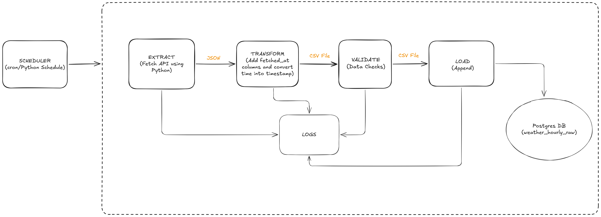
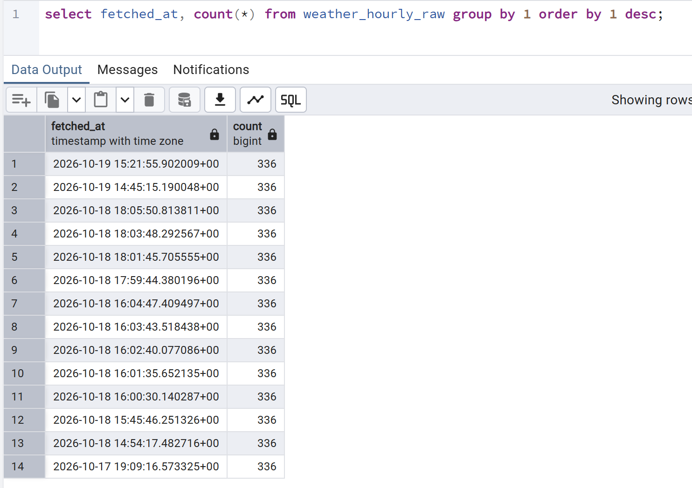

# Weather Pipeline

Weather forecasts change from one run to the next. This pipeline pulls a 14-day hourly forecast for one location from the [Open-Meteo API](https://open-meteo.com/) every 6 hours and keeps every run in Postgres, so you can see how the forecast for the same hour changed over time. It is a batch ETL pipeline: four separate Python stages (extract, transform, validate, load) run in order. They are scheduled by an Apache Airflow DAG (see [Orchestration with Airflow](#orchestration-with-airflow)), which also loads each run into Delta tables in Databricks (see [Databricks branch](#databricks-branch)). The first version used a small Python scheduler instead; it still works on its own (see [Run it](#run-it)) but Airflow is the recommended way to run the pipeline.

## Architecture



## Pipeline stages

1. **Extract** (`open_api_requests.py`): calls the API with `requests`, saves the JSON response and writes the hourly data to a CSV. It adds a `fetched_at` column, stamped in UTC right after the API call returns, which identifies the run.
2. **Transform** (`transform.py`): converts `time` from text to a timestamp, from IST (Asia/Kolkata) to UTC, and `fetched_at` to a UTC timestamp.
3. **Validate** (`validate.py`): checks the transformed data: row counts (input equals output, 336 rows = 24 hours x 14 days), no nulls, values in plausible ranges, no duplicate (`time`, `fetched_at`) pairs, and a single `fetched_at` per run. Any failure exits with a non-zero code.
4. **Load** (`data_load.py`): creates the `weather_hourly_raw` table if needed and inserts the rows, skipping any that already exist (`ON CONFLICT DO NOTHING`).

Around the stages:

- **Scheduler** (`scheduler.py`, superseded by Airflow, see below): runs the four stages in order using the `schedule` library, once at startup and then on an interval set by `SCHEDULE_INTERVAL_MINUTES` (360 = 6 hours). Each stage's exit code decides whether the next one runs.
- **Postgres**: a Postgres 16 container with a health check; the data lives in a named Docker volume.

## Design decisions

- **Append-only history.** Every run adds 336 rows. The primary key is (`time`, `fetched_at`), so the same forecast hour can appear once per run.
- **Idempotent load.** Loading the same run twice inserts nothing (conflicts are skipped); a new run adds new rows.
- **Atomic load.** The table creation and insert run in one transaction, so a failed load leaves all rows or none.
- **Failure handling.** A failed stage is logged with its name and exit code, later stages do not run, and nothing is loaded. The scheduler stays alive and tries again at the next interval.
- **Retry with backoff.** Extract retries timeouts, connection errors and 5xx responses up to 5 times, waiting 5s, 10s, 20s and 40s between attempts. 4xx errors fail immediately because retrying a bad request cannot help. If every attempt fails, Extract exits non-zero and the failure handling above applies.
- **Logging.** Each stage writes its own log file to `output/`.

## Tech stack

Python 3.11, `requests` 2.34.2, `pandas` 3.0.5, SQLAlchemy 2.1.3 with `psycopg2-binary` 2.9.13, `schedule` 1.2.2, Postgres 16, Docker Compose. Under Airflow: Apache Airflow 3.3 (Celery executor) and Databricks Free Edition (Delta Lake, PySpark).

## Data

Hourly forecasts for one location (set in the API URL in `open_api_requests.py`), stored in the `weather_hourly_raw` table with these columns: `time`, `temperature_2m`, `apparent_temperature`, `precipitation_probability`, `rain`, `showers` and `fetched_at`.

In Databricks (Airflow only) the same rows go into a Delta table of the same name, and a second table, `weather_daily_ist`, holds one row per IST date with `avg_temp`, `max_feels_like` and `total_rain`.

## Run it

This section starts the standalone version, with the built-in `scheduler.py` and no Airflow. For the Airflow version, see [Orchestration with Airflow](#orchestration-with-airflow). Do not run both at the same time (see [Limitations](#limitations)).

You need Docker and Docker Compose.

1. Create the shared Docker network once: `docker network create weather_net`. The Compose file declares it as `external`, so Compose expects it to exist and does not create it.
2. Create your settings file from the template and fill in the values:
   ```
   cp .env.example .env
   ```
   It holds the database credentials, `SCHEDULE_INTERVAL_MINUTES`, and `POSTGRES_HOST` / `POSTGRES_PORT` for running the scripts outside Docker (inside Compose, the host and port are set for you).
3. Build and start everything:
   ```
   docker compose up --build -d
   ```
   The first pipeline run starts immediately. Follow it in `output/scheduler.log`.
4. Look at the data: connect any Postgres client (pgAdmin, psql) to `localhost`, port `5433`, with the database name, user and password from your `.env`, and run:
   ```sql
   SELECT fetched_at, COUNT(*) FROM weather_hourly_raw GROUP BY 1 ORDER BY 1 DESC;
   ```
   Each run shows up as one `fetched_at` value with 336 rows.

   

To stop everything: `docker compose down`. Add `-v` to also delete the database volume (and with it, the whole run history).

## Orchestration with Airflow

The `airflow/` folder runs the same four stages as an Airflow 3 DAG (`weather_pipeline_dag`) with the Celery executor, instead of the built-in `scheduler.py`.

**How the DAG works**

- Four `PythonOperator` tasks run in order: `extract >> transform >> validate >> load`. Each task calls the stage's `main()`. The stage modules are imported inside the task functions, so parsing the DAG never runs pipeline code.
- After `validate`, a second branch loads the same CSV into Databricks: `databricks_upload >> run_notebook`. It runs in parallel with `load` and does not depend on it (see [Databricks branch](#databricks-branch)).
- Schedule `0 */6 * * *` (00:00, 06:00, 12:00 and 18:00 UTC), `catchup=False` and `max_active_runs=1`.
- If a task fails, the tasks after it are marked `upstream_failed` and do not run. Validation raises an error on any failed check, so bad data never reaches `load`.

**Retries**

| Task | Retries | Why |
|---|---|---|
| `extract` | 1, after 5 minutes | The script already makes up to 5 attempts with backoff on transient errors; this covers a longer outage. |
| `transform` | 0 | Deterministic: the same input always gives the same output, so a retry cannot help. |
| `validate` | 0 | Deterministic: a failed check means the data is bad. Fail fast so nothing bad is loaded. |
| `load` | 2, after 2 minutes each | Database errors can be transient. The load is one transaction and idempotent, so a retry is safe. |
| `databricks_upload` | 1, after 1 minute | The script already retries transient errors with backoff. The upload overwrites the file, so repeating it is safe. |
| `run_notebook` | 1, after 5 minutes | The notebook's MERGE is idempotent, so a retry is safe. Each attempt uses serverless compute quota, so it stays at 1. |

`max_active_runs=1` is there because the stages pass data to each other through CSV files in the shared `output/` folder, so two overlapping runs could overwrite each other's files. `catchup=False` skips missed intervals instead of replaying them, which is what a forecast pipeline wants.

**Run it**

1. Create the shared Docker network once: `docker network create weather_net`
2. From the repo root, start only the database: `docker compose up -d postgres`. Do not start the `pipeline` service as well, or its own scheduler and Airflow would both write to the same table.
3. `cd airflow`, then `cp .env.example .env` and fill in `POSTGRES_USER`, `POSTGRES_PASSWORD` and `POSTGRES_DB` with the same values as the root `.env`. Keep `POSTGRES_HOST=my_postgres` and `POSTGRES_PORT=5432`.
4. First time only: `docker compose up airflow-init`. Then `docker compose up -d --build`. The `--build` is needed because the Airflow image is built from `airflow/Dockerfile` (it adds the Databricks provider).
5. Open http://localhost:8080 (login `airflow` / `airflow`) and unpause `weather_pipeline_dag`.

**How the two stacks connect**

The Postgres stack and the Airflow stack each have their own default Docker network, so containers in one cannot see the other. `weather_net` is a shared network created outside both Compose files and declared `external: true` in each, so Compose uses it and never creates or deletes it. Docker's built-in DNS lets containers on it find each other by name.

- The database container joins `weather_net` as well as its default network.
- Only the Airflow `worker` joins `weather_net`, because it is the only service that runs the `load` task.
- Both stacks have a service called `postgres`, and Airflow has its own metadata database. So the load connects to `my_postgres`, the unique `container_name` of the weather database, on the container port 5432. `localhost` would mean the worker container itself.

## Databricks branch

Under Airflow, every run is also loaded into Delta tables in Databricks Free Edition, next to the Postgres load. The Postgres path was left as it is: Databricks is a second branch after `validate`, not a rewrite.

**How it works**

- `load` (Postgres) and `databricks_upload >> run_notebook` both start after `validate`. They do not depend on each other, so a Databricks failure does not stop the Postgres load, and the reverse.
- `databricks_upload` (`databricks_upload.py`) is a `PythonOperator`. It sends `output/transformed_forecast_data.csv` to a Unity Catalog volume (`/Volumes/workspace/default/raw_files/`) with the Databricks Files API (`PUT` with `overwrite=true`, authenticated with a personal access token). It retries timeouts, connection errors, 429 and 5xx responses up to 5 times with backoff (5s, 10s, 20s, 40s). Other 4xx errors, such as an expired token (401), fail immediately because retrying cannot help.
- `run_notebook` is a `DatabricksSubmitRunOperator`. It submits the `weather_load` notebook as a one-time run on serverless compute and waits for it to finish.
- The notebook (PySpark) reads the CSV, merges it into the Delta table `weather_hourly_raw`, and rebuilds `weather_daily_ist`.

**Tables**

| Table | Contents |
|---|---|
| `weather_hourly_raw` | Same columns as the Postgres table, one row per (`time`, `fetched_at`). Append-only history of every forecast. |
| `weather_daily_ist` | One row per IST date: `avg_temp`, `max_feels_like`, `total_rain`. Uses the latest forecast for each hour. |

**Design decisions**

- **Idempotent load.** The notebook uses `MERGE ... WHEN NOT MATCHED THEN INSERT *` on (`time`, `fetched_at`), the same rule as `ON CONFLICT DO NOTHING` in Postgres. Loading the same CSV twice adds nothing.
- **Latest forecast per hour.** A window function (`row_number` over `time`, ordered by `fetched_at` descending) keeps the newest forecast for each hour before the daily aggregation.
- **IST dates, not UTC.** The transform stores UTC, but days are meaningful in IST. Grouping by UTC date would split a 14-day forecast into 15 partial dates.
- **Full rebuild of the daily table.** `weather_daily_ist` is overwritten on each run. That is simple and fine at this size; on a large table I would refresh only the affected dates.
- **Delta Lake.** ACID writes, schema enforcement (a badly shaped append is rejected) and time travel on the tables.

**Set it up**

You need a Databricks Free Edition account.

1. In Databricks, create a volume `raw_files` in `workspace.default`, and a notebook named `weather_load` with the PySpark steps above.
2. Create a personal access token. Mine expires after 30 days.
3. In `airflow/.env` set `DATABRICKS_URL` (workspace URL), `DATABRICKS_USERNAME` (the user folder holding the notebook) and `DATABRICKS_TOKEN`. These stay out of Git; `airflow/.env.example` has placeholders.
4. From `airflow/`, rebuild with `docker compose up -d --build`. The custom image (`airflow/Dockerfile`) adds `apache-airflow-providers-databricks` (pinned).
5. Create the Airflow connection once. It is stored in Airflow's metadata database, so it is lost if that Docker volume is deleted:
   ```
   docker compose exec airflow-scheduler sh -c 'airflow connections add databricks_default --conn-type databricks --conn-host "$DATABRICKS_URL" --conn-password "$DATABRICKS_TOKEN"'
   ```

**Good to know**

- Clearing a `run_notebook` that already succeeded does not run the notebook again: the operator sees the earlier Databricks run and skips it. Start a new DAG run instead.

## Project layout

```
open_api_requests.py   extract: fetch the API data, write JSON and CSV
transform.py           transform: fix timestamps and time zones
validate.py            validate: data quality checks
data_load.py           load: append the rows into Postgres
databricks_upload.py   upload: send the transformed CSV to a Databricks volume (Airflow only)
scheduler.py           run extract, transform, validate and load in order, on a schedule (standalone mode, without Airflow)
Dockerfile             image used by the pipeline service
docker-compose.yml     the postgres and pipeline services
requirements.txt       pinned Python dependencies
.env.example           template for the settings
docs/architecture.png  architecture diagram
airflow/               Airflow stack: docker-compose.yaml, Dockerfile, dags/weather_pipeline_dag.py, .env.example
```

## Limitations

### Addressed since the first version

| Early limitation | How it was addressed |
|---|---|
| The load replaced the whole table on every run, so no history was kept. | The load is append-only with a (`time`, `fetched_at`) key and `ON CONFLICT DO NOTHING`, so every run is kept and a repeated run adds nothing. |
| `time` was stored as text. | The transform stage converts `time` and `fetched_at` to UTC timestamps before loading. |
| There was no scheduler. | `scheduler.py` runs the stages on an interval, and the Airflow DAG now schedules them with per-task retries, `catchup=False` and `max_active_runs=1`. |
| Retries covered only the API call, and a failed stage waited for the next interval. | Under Airflow, `load`, `databricks_upload` and `run_notebook` have their own retries. |
| No resume from the failed stage: the next run started again from Extract. | Airflow replaces the standalone scheduler. Clearing a failed task re-runs it and the tasks after it, without fetching the data again. |
| Only a raw landing table, with nothing built on top of it. | In Databricks, `weather_daily_ist` aggregates the latest forecast per IST date. A proper modelling layer is still open (see below). |

### Still open

**Pipeline**

- No alerting. A failed run is only visible in the Airflow UI or the logs, so someone has to check. I would add failure callbacks (email or Slack), plus a freshness check that alerts when no new `fetched_at` has landed in the last few hours.
- The stages share files in the `output/` folder, so safety against overlapping runs comes from `max_active_runs=1`, not from the design. It would also break with workers on different machines. 
- The standalone `pipeline` service (`scheduler.py`) is superseded by Airflow but is still in `docker-compose.yml`, and it writes to the same `output/` folder. `docker compose up` starts it, and running it alongside Airflow can overwrite a CSV while another stage is using it, so the two stores then receive different batches. For now, start only Postgres (`docker compose up -d postgres`). The fix is to retire the service (or put it behind a Compose profile so `up` does not start it).
- The Postgres table grows without limit (336 rows per run, about 1,344 a day at 6-hour intervals) and there is no retention policy.
- The location and forecast length are fixed in the script.
- There is no modelling layer yet (tested models, views, documentation) on top of the raw data.

**Security (local setup)**

- `FERNET_KEY` is empty in the Airflow stack, so Airflow stores connection secrets, including the Databricks token, unencrypted in its metadata database. Setting a Fernet key fixes that, but the connection then has to be created again.
- The Airflow web login is the default `airflow` / `airflow` and the example DAGs are loaded. That is fine on a local machine, but not for anything shared.

**Databricks branch**

- The calls use a personal access token that expires (30 days in my setup). After that the upload fails with a 401 and the Databricks branch stops until a new token is created and put in `airflow/.env`. The Postgres branch is not affected.
- Databricks Free Edition has a daily compute quota, and a 6-hourly schedule means 4 serverless notebook runs a day. When the quota runs out, `run_notebook` fails until it resets. The edition is also for non-commercial use, and inactive accounts can be removed.
- Postgres and Databricks load independently and are not atomic together, so they can hold different batches. Each run loads the CSV it fetched, and neither store backfills the other.
- `weather_daily_ist` is rebuilt in full on each run. That is fine at this size, but a large table would need an incremental refresh of the affected dates.
- The `weather_load` notebook lives in the Databricks workspace and is not stored in this repo, so its code is not version-controlled.
- Airflow runs on a local machine, so runs only happen while it is on and Docker is running. Missed intervals are not replayed (`catchup=False`).
